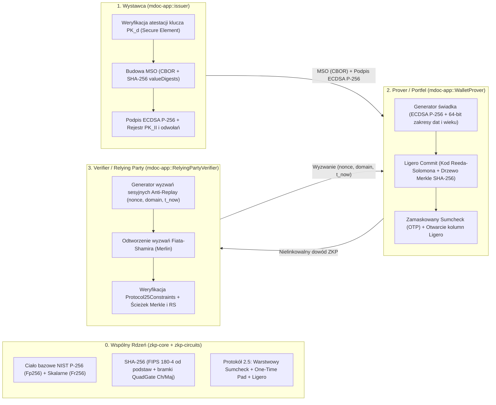

# ZeroAge — System Anonimowych Poświadczeń Wieku (ZKP) w Rust
### Implementacja architektury *Anonymous Credentials from ECDSA* (Frigo & shelat) ze zgodnością ze standardami **SHA-256**, **NIST P-256 (ECDSA)** oraz **ISO 18013-5 (mDL / MDOC)**

---

## 1. Koncepcja Kryptograficzna i Architektoniczna

Projekt **ZeroAge** realizuje w języku **Rust** system nieinteraktywnych dowodów z wiedzą zerową (**NIZKP**) dla poświadczeń tożsamości i pełnoletności ($\text{wiek} \ge 18$), oparty na publikacji Matteo Frigo i abhi shelata (*"Anonymous Credentials from ECDSA"*, IACR CiC / IEEE S&P, referencyjna koncepcja `google/longfellow-zk`).

Najważniejsza cecha architektury: **Wystawca poświadczenia (Issuer, np. państwowy urząd wydający mDowód / mDL) nie potrzebuje żadnej kryptografii ZK** — działa zgodnie ze standardem **ISO 18013-5**, budując obiekt `MobileSecurityObject` (`MSO`) w formacie **CBOR (RFC 8949)** ze skrótami **SHA-256** (`valueDigests`) i podpisując go klasycznym algorytmem **ECDSA nad krzywą NIST P-256 (`secp256r1`)**.



---

## 2. Struktura Workspace'u Cargo

Repozytorium podzielone jest na trzy współpracujące pakiety (crates) w katalogu `crates/`:

```text
ZeroAge/
├── Cargo.toml                         # Definicja workspace'u Cargo
├── Cargo.lock                         # Zablokowane wersje zależności dla powtarzalnych buildów CI
└── crates/
    ├── zkp-core/                      # 0. Rdzeń kryptograficzny systemu dowodowego
    │   ├── src/field/                 #    - Wielomiany MLE oraz ciało bazowe NIST P-256 (Fp256) i Goldilocks (F64)
    │   ├── src/circuit/               #    - Bramki kwadratowe QuadGate (w tym bramki bitowe SHA-256) i obwody warstwowe
    │   ├── src/sumcheck/              #    - Prover i Verifier wielowarstwowego protokołu Sumcheck (stopień 2)
    │   ├── src/protocol25/            #    - Maski One-Time Pad (LayerPads) i więzy liniowe/kwadratowe Protokołu 2.5
    │   ├── src/rs_code/               #    - Systematyczny koder Reeda-Solomona z prekomputacją barycentryczną
    │   ├── src/merkle/                #    - Binarne drzewo Merkle'a oparte na SHA-256 i ścieżki uwierzytelniające
    │   ├── src/ligero/                #    - Macierz świadka z wierszem maskującym ZK, LigeroProver i LigeroVerifier
    │   ├── src/transcript/            #    - Nieinteraktywny transkrypt Fiata-Shamira (Merlin)
    │   └── examples/                  #    - 7 przykładów i benchmarków poszczególnych warstw silnika
    │
    ├── zkp-circuits/                  # 1. Biblioteka obwodów aplikacyjnych (SHA-256, ECDSA P-256, Wiek/Daty)
    │   └── src/
    │       ├── sha256.rs              #    - Pełna funkcja FIPS 180-4 SHA-256 od podstaw + kompilator bramek Ch/Maj/ROTR
    │       ├── ecdsa_p256.rs          #    - Krzywa NIST P-256 (secp256r1), podpisy ECDSA oraz obwód weryfikacji punktów (Alg. 4)
    │       └── age_circuit.rs         #    - Obwód 64-bitowej dekompozycji wieku >= 18 oraz okna ważności t_start <= t_now <= t_end
    │
    └── mdoc-app/                      # 2. Warstwa poświadczeń ISO 18013-5 (Wystawca, Portfel Provera, Weryfikator)
        ├── src/
        │   ├── mso.rs                 #    - Model MobileSecurityObject (MSO), IssuerSignedItem, koder CBOR i format 183B (Alg. 9)
        │   ├── issuer.rs              #    - StateIssuer, DeviceKeyAttestation (Secure Element PoP), TrustedIssuerRegistry
        │   └── presentation.rs        #    - WalletProver i RelyingPartyVerifier (pełny przepływ Protokołu 2.5 + Anti-Replay)
        └── examples/
            └── demo_mdoc_flow.rs      #    - Kompleksowa demonstracja wydania MSO, generacji dowodu ZKP i testów ataków
```

---

## 3. Kluczowe Komponenty Kryptograficzne

### 3.1. Funkcja Skrótu FIPS 180-4 `SHA-256` Zbudowana od Podstaw (`crates/zkp-circuits/src/sha256.rs`)
Moduł implementuje od zera pełny algorytm **SHA-256** (stałe `SHA256_H0`, `SHA256_K`, harmonogram wiadomości $\sigma_0, \sigma_1$, funkcję kompresji `sha256_compress` oraz dopełnianie Merkle-Damgårda `sha256_pad_message`), zweryfikowany w testach jednostkowych względem oficjalnych wektorów NIST.
W warstwie obwodu ZKP nad $\mathbb{F}_{p_{256}}$ wykorzystuje optymalizacje algebraiczne:
* **Rotacje `ROTR` i przesunięcia `SHR` za 0 bramek:** realizowane przez statyczną permutację indeksów 32 przewodów bitowych (`rotr32_wires`, `shr32_wires`).
* **1-bramkowa funkcja wyboru `Ch(e, f, g)`:**
  $$\text{Ch}(x, y, z) = z + x \cdot (y - z) \pmod{p_{256}}$$
* **2-bramkowa funkcja większościowa `Maj(a, b, c)`:**
  $$t = x \cdot y, \qquad \text{Maj}(x, y, z) = t + x \cdot z + y \cdot z - 2 \cdot t \cdot z \pmod{p_{256}}$$

### 3.2. Weryfikacja Krzywej NIST P-256 (`secp256r1`) bez Narzutu Obcego Ciała (`crates/zkp-circuits/src/ecdsa_p256.rs`)
Ponieważ obwód pracuje bezpośrednio nad ciałem bazowym krzywej NIST P-256:
$$p_{256} = 2^{256} - 2^{224} + 2^{192} + 2^{96} - 1$$
weryfikacja przynależności punktów $Q = (Q_x, Q_y)$ oraz $R = (R_x, R_y)$ do krzywej $y^2 = x^3 - 3x + b \pmod{p_{256}}$ oraz sprawdzenie siecznej dodawania punktów $\lambda(x_2 - x_1) = y_2 - y_1$ wykonywane są natywnie w dwóch warstwach kwadratowych (`build_p256_ecdsa_curve_circuit`).

### 3.3. Moduł Wystawcy (`crates/mdoc-app/src/issuer.rs`) i Obiekt MSO (`crates/mdoc-app/src/mso.rs`)
* **Weryfikacja atestacji urządzenia (`DeviceKeyAttestation`):** sprawdza podpis Proof-of-Possession z Secure Elementu dla klucza $PK_d$ na krzywej P-256.
* **Budowa `MobileSecurityObject` (`MSO`) w CBOR:** losuje 16-bajtowe sole `random` dla atrybutów (`birth_date`, `age_over_18`), wylicza ich skróty `SHA-256(CBOR(IssuerSignedItem))` do mapy `valueDigests`, dołącza `deviceKeyInfo` oraz `validityInfo`, po czym podpisuje `SHA-256(CBOR(MSO))` kluczem prywatnym wystawcy (`ECDSA P-256`).

---

## 4. Uruchamianie Testów, Demonstracji i Benchmarków

### 1. Uruchomienie wszystkich testów jednostkowych i integracyjnych (33 testy w całym workspace)
```bash
cargo test --workspace
```

### 2. Uruchomienie pełnej demonstracji End-to-End (Issuer $\to$ Prover $\to$ Verifier + Symulacje Ataków)
```bash
cargo run -p mdoc-app --example demo_mdoc_flow
```

### 3. Uruchomienie poszczególnych przykładów i benchmarków silnika `zkp-core`
```bash
# Demonstracja Protokołu 2.5 (Sumcheck + One-Time Pad + Ligero)
cargo run -p zkp-core --example demo_protocol25

# Pełny benchmark wydajnościowy silnika w trybie release (F_p64 vs NIST F_p256)
cargo run -p zkp-core --example bench_engine --release
```
