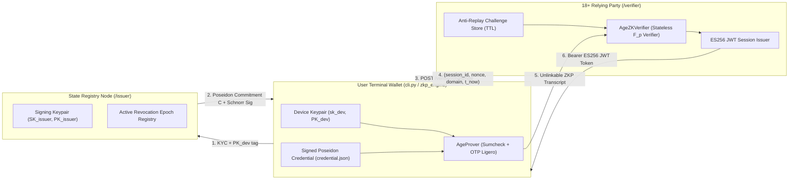
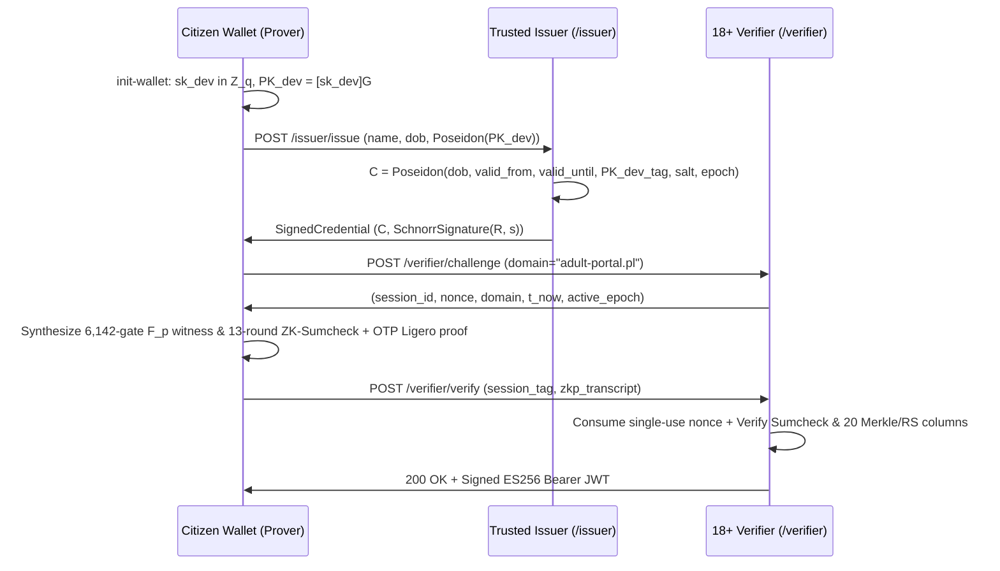

# ZeroAge — 100% Pure-Python Zero-Knowledge Age Verification System

**ZeroAge** is an anonymous, unlinkable **18+ Zero-Knowledge Proof (ZKP) Age Verification MVP** implemented in **100% pure Python** (requiring zero C++, Rust, or Circom toolchains).

Instead of boolean-heavy SHA-256 circuits (~25,000 gates/block), ZeroAge combines:
1. **Algebraic Poseidon Sponge Hashing** over the **BN254 scalar prime field** $\mathbb{F}_p$ ($t=3, R_F=8, R_P=56, x \mapsto x^5$, only **240 quadratic gates** per permutation).
2. **Embedded BabyJubjub Twisted Edwards Signatures & Device Binding** over the exact same field $\mathbb{F}_p$ (EIP-2494 complete group addition with zero point-at-infinity edge cases).
3. **Zero-Knowledge Sumcheck + One-Time Pad (OTP) Ligero** over rank-1 quadratic circuits `Q[g, l, r]`, inspired by *Anonymous Credentials from ECDSA* (Frigo & shelat, DOI: `10.62056/a3qjmpgxq`).

---

## System Architecture



### Protocol Sequence



---

## Cryptographic Design & Circuit Constraints

Over the BN254 scalar field $p = 21888242871839275222246405745257275088548364400416034343698204186575808495617$:

1. **Credential Integrity & Unlinkability**:
   - The Issuer signs $C = \text{Poseidon}(\text{dob\_timestamp}, \text{valid\_from}, \text{valid\_until}, \text{device\_pub\_key}, \text{secret\_salt}, \text{revocation\_epoch}) \in \mathbb{F}_p$ using Poseidon-Schnorr over BabyJubjub: $[s]G = R + [e]\text{PK}_{\text{issuer}}$.
   - Inside the quadratic circuit, $(R_x, R_y, s)$ and $C$ are **private witness wires**; neither $C$ nor $(R, s)$ ever leaves the user's wallet.
2. **Age $\ge 18$ Without Modular Underflow (Security Test 1)**:
   - Computes $\Delta_{\text{age}} \equiv t_{\text{now}} - \text{dob\_timestamp} - \text{AGE\_18\_SECONDS} \pmod p$.
   - Enforces a **64-bit boolean decomposition**:
     $$\sum_{i=0}^{63} b_i \cdot 2^i \equiv \Delta_{\text{age}} \pmod p \quad \text{and} \quad b_i \cdot (b_i - 1) \equiv 0 \pmod p$$
   - An underage user (e.g., 17 years old) produces a negative difference wrapping around to $p - |\text{deficit}| \approx 2^{254} \gg 2^{64} - 1$, which has **no solution** in $\{0, 1\}^{64}$.
3. **Validity Window & Epoch Revocation (Security Test 4)**:
   - Enforces 64-bit range decompositions on $t_{\text{now}} - \text{valid\_from} \ge 0$ and $\text{valid\_until} - t_{\text{now}} \ge 0$, plus `cred.revocation_epoch == active_revocation_epoch`.
4. **Device Binding & Anti-Replay Fiat-Shamir Binding (Security Test 2)**:
   - Proves knowledge of `device_priv_key` regenerating `device_pub_key` inside $C$, emits session-blinded `session_tag = Poseidon(sk_dev, h_chal, r_sess)`, and binds the entire Sumcheck + Ligero Fiat-Shamir sponge to `h_chal = Poseidon(nonce, domain, t_now)`.

| Gate Category | Constraint Count | Purpose |
| :--- | ---: | :--- |
| **Poseidon Permutations** | `2,160` | 9 algebraic permutations ($t=3, R_F=8, R_P=56, x^5$) |
| **Bit-Decomposition & Range** | `954` | Three 64-bit underflow checks + scalar/challenge bit constraints |
| **BabyJubjub Curve Auth** | `3,024` | 2-bit windowed complete Twisted Edwards scalar muls & curve check |
| **Public Input Equality** | `4` | Issuer key & active revocation epoch wire bindings |
| **Total Active / Padded** | `6,142 / 8,192` | $2^{13}$ ZK-Sumcheck hypercube + 512-column Radix-2 NTT OTP Ligero |

---

## Project Structure

```text
ZeroAge/
├── app/
│   ├── main.py                 # FastAPI app factory, CORS middleware, router mounting
│   ├── models.py               # Pydantic v2 schemas for Issuer, Verifier, and ZKP transcripts
│   ├── issuer.py               # /issuer endpoints, BabyJubjub keys, epoch revocation registry
│   └── verifier.py             # /verifier endpoints, TTL anti-replay store, ES256 JWT issuer
├── zkp_engine/
│   ├── poseidon.py             # SAFE Poseidon sponge & Fiat-Shamir transcript over BN254 F_p
│   ├── crypto_primitives.py    # BabyJubjub curve, Poseidon/Pedersen commitments, Schnorr, ES256 JWT
│   ├── circuit.py              # Q[i,l,r] quadratic circuit, Radix-2 NTT, ZK-Sumcheck + OTP Ligero
│   ├── prover.py               # High-level AgeProver & constraint telemetry
│   └── verifier_zk.py          # High-level stateless AgeZKVerifier
├── tests/
│   └── test_security_suite.py  # Pytest suite covering all 5 mandatory security tests
├── cli.py                      # Typer + Rich terminal client & interactive demo-all showcase
├── requirements.txt            # Pure-Python dependencies
└── README.md
```

---

## Quickstart & Usage

### 1. Install Dependencies
```bash
pip install -r requirements.txt
```

### 2. Run the Automated Security Test Suite (`pytest`)
```bash
pytest -v
```

### 3. Run the Full Interactive End-to-End & Security Attack Demo
```bash
python cli.py demo-all
```

### 4. Step-by-Step Wallet CLI Commands
You can run the FastAPI backend in one terminal (optional—`cli.py` also supports automatic local ASGI routing if no external Uvicorn process is running):
```bash
uvicorn app.main:app --host 127.0.0.1 --port 8000 --reload
```

Then execute the citizen workflow:
```bash
# 1. Generate local BabyJubjub device keypair in ~/.zkp_wallet/device_key.json
python cli.py init-wallet

# 2. Request a signed Poseidon credential into ~/.zkp_wallet/credential.json
python cli.py issue --name "Jan Kowalski" --dob "2005-05-10"

# 3. Prove age >= 18 in zero-knowledge and receive a signed ES256 JWT session token
python cli.py verify-age --domain "adult-portal.pl"
```
